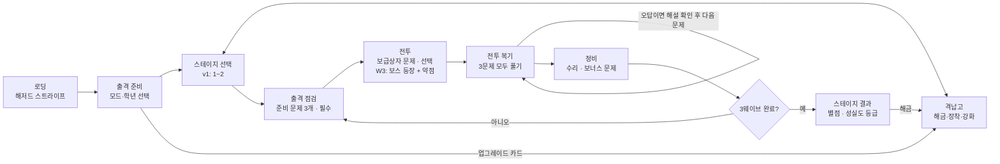

# 방파제 디펜스 — Claude Code 인수인계

이 파일은 `docs/PRD.md`(방파제 디펜스 PRD)와 함께 쓰는 보조 문서다. PRD를 Markdown으로 내보내면 "2. 전체 화면 흐름" 다이어그램이 빠지므로, 아래 Mermaid 도식이 그 자리를 대신한다.

## 1. 화면 흐름 (PRD 2장 다이어그램 대체)



## 2. 확정된 결정 (2026-10-30)

- v1 범위: 스테이지 1~2, **수학만**. 스테이지 3 이후 카드는 'COMING SOON'.
- 저장: **로컬 저장(IndexedDB)**만. 서버 없음. 닉네임 프로필(기기당 최대 30명), 기록 내보내기/가져오기(JSON).
- 전투 복기: **3문제를 모두 풀면 다음 웨이브**. 정답률 보상 없음. 오답이면 해설 카드 최소 3초 + '이해했어요'를 눌러야 진행.
- 아트: 생성형 도구(Midjourney/Scenario/Leonardo → Meshy/Tripo/Rodin) + Blender MCP로 정리 → GLB(Draco).
- 보스 약점: GLB 안에서 이름이 `weak_`로 시작하는 오브젝트를 약점 히트박스로 자동 인식(예: `weak_head`, `weak_core`).

## 3. 작업 원칙 (Claude Code에게)

- 각 마일스톤을 시작하기 전에 계획을 먼저 보여주고 승인을 받는다.
- 아트가 아직 없으면 **임시 도형(박스·캡슐)으로 먼저 구현**한다. 에셋은 `public/assets/` 아래 GLB로 나중에 교체한다.
- 게임 수치(공격력, 보상, 강화 비용 등)는 코드에 흩어 두지 말고 `src/config/balance.ts` 한 곳에 모은다. PRD 수치는 초안이며 플레이 테스트로 조정한다.
- 문제 데이터는 `src/data/questions/*.json`(PRD 8.1 스키마)으로 분리한다.
- 상태 전환은 PRD 9.3 상태 머신을 따른다. 특히 COMBAT→DEBRIEF(남은 괴수 0), DEBRIEF→MAINTENANCE(복기 3문제 완료) 조건은 테스트로 고정한다.
- 크롬북 수준 기기에서 45fps를 목표로 한다.

## 4. 첫 지시문 (복사해서 붙여넣기)

```
docs/PRD.md와 docs/CLAUDE_CODE_HANDOFF.md를 읽어줘.
이 게임의 M1 프로토타입(PRD 10.2)을 만들 계획을 세워줘:
React + TypeScript + Vite + react-three-fiber + Zustand.
범위는 바다·포탑·꼬마 게 1종, 출격 점검 → 전투 → 전투 복기 → 정비 흐름,
수학 3-1 문항 샘플 20개. 아트는 임시 도형으로.
코드 쓰기 전에 폴더 구조와 작업 순서를 먼저 보여줘.
```
